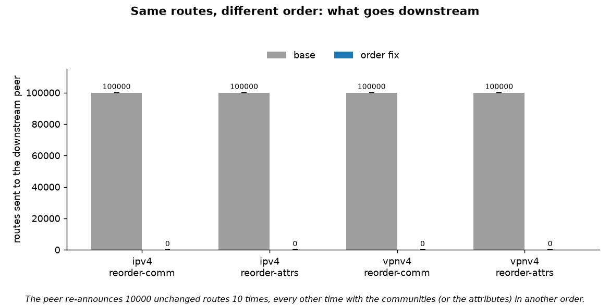
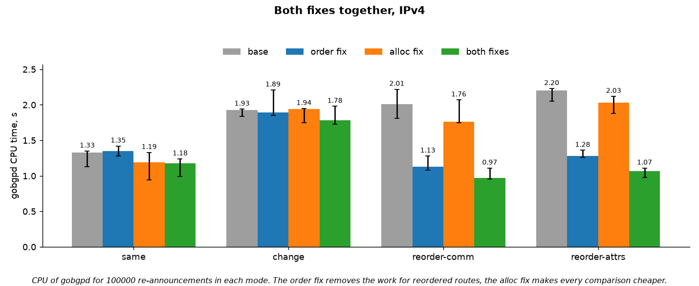

# gobgp Path.Equal bench

Measures two fixes to [GoBGP](https://github.com/osrg/gobgp) on a live gobgpd
([PR](https://github.com/homka122/gobgp/pull/1)). Both are about the check gobgpd runs for every
re-announced route: `Path.Equal`, "is this the same route I already have?". If it says no, the
route gets a new age and is sent again to every peer.

- **order**: the attributes hash covered the attributes in the order they came in, so the same
  route with its attributes or communities in another order counted as changed. Received
  attributes and COMMUNITIES are now sorted before hashing.
- **alloc**: `Path.Equal` copied the attributes of both routes and serialized both prefixes on
  every call. It now reads the attributes in place and compares IP prefixes as values.

## Result

| | before | after |
|---|---|---|
| Reordered re-announcements sent downstream | 100 000 | **0** |
| gobgpd CPU in that storm | 2.0–2.2 s | **1.1–1.3 s** (−42…44%) |
| gobgpd CPU when the order is stable | 1.93 s | 1.89 s |
| Garbage per re-announcement of an unchanged route, bytes | 6193 | **5521** (−11%) |
| Memory of the initial load | | no change¹ |

¹ +0.8% when the communities of every route arrive reversed: the order fix copies them once per UPDATE.





More charts: [CPU in a reorder storm](results/full/plots/2-cpu-reorder.png),
[cost when the order is stable](results/full/plots/3-cpu-change.png),
[`Path.Equal` benchmark](results/full/plots/4-equal-micro.png),
[storm of unchanged routes](results/full/plots/5-alloc-storm.png),
[initial load](results/full/plots/7-initial-load.png).
All numbers: [summary.md](results/full/summary.md), raw data: [results/full](results/full).

## `Path.Equal` allocations

`go test`, one call on two received copies of the same route. `Path.Equal` runs twice per received
route (Adj-RIB-In and the main table), so a re-announcement saves twice this.

| | before | after |
|---|---|---|
| ns | 181 | **9** |
| bytes | 224 | **0** |
| allocations | 10 | **0** |

The same holds for VPN prefixes. For the whole receive chain (`ProcessMessage → AdjRib →
TableManager`) the allocations per re-announcement go from 58 to 38.

## How it works

```
sender ──BGP──▶ gobgpd under test ──BGP──▶ receiver
```

- The sender is a minimal BGP speaker that builds every UPDATE itself, so it can re-send the same
  routes with the attributes or communities in another order.
- It announces 10 000 routes, then re-announces them 10 times: unchanged, changed, or reordered.
- The receiver counts what gobgpd passes on; CPU and memory of gobgpd are read from outside,
  before and after each phase.
- gobgpd is built from the same base without the fixes, with each one, and with both; 3 runs
  each, medians.

## Run it

```bash
make docker-all   # ~5 min, results in results/full
```

<details>
<summary>Details</summary>

### Code under test

Branch [`path-equal`](https://github.com/homka122/gobgp/tree/path-equal) on top of osrg/gobgp
master `e9ac84bf`, pinned in [versions.env](versions.env).

| Variant | Code |
|---|---|
| `base` | `e9ac84bf`, upstream master |
| `order` | base + [`6f6cc2a7`](https://github.com/homka122/gobgp/commit/6f6cc2a78b94ee8092411baca0fa6df48b3c53ce) |
| `alloc` | base + [`127d1ef8`](https://github.com/homka122/gobgp/commit/127d1ef857eebd310285c08b0d7072da20e75079), [`65721d4e`](https://github.com/homka122/gobgp/commit/65721d4eaf6bd45ad86b4f2f915f9765fcb354cb), [`03fda3a9`](https://github.com/homka122/gobgp/commit/03fda3a94b997b07c38e0da488461dc41ac26272) |
| `both` | base + all four |

### Scenarios

| Mode | What the sender does in each of the 10 rounds |
|---|---|
| `same` | the same bytes |
| `change` | one community value changes, so every route really changes |
| `reorder-comm` | every other round the communities come in reverse order |
| `reorder-attrs` | every other round COMMUNITIES comes before the other attributes |

In the reorder modes the initial load already uses the reordered form. 4 variants × 4 modes ×
3 runs = 48 runs, IPv4 unicast; `--families ipv4,vpnv4` adds VPNv4.

### Measurement

- Docker VM with 4 CPUs on an Apple M2, Go 1.27.2. gobgpd is pinned to CPUs 0–1 with
  `GOMAXPROCS=2`, the sender and the receiver to CPUs 2–3.
- A phase ends when a marker route sent after it reaches the receiver.
- CPU and RSS of gobgpd come from psutil; `runtime.MemStats` from the gobgpd pprof page, read once
  before and once after a phase (the read itself allocates ~36 KiB inside gobgpd); GC cycles from
  `GODEBUG=gctrace=1`. Nothing else polls gobgpd while it works.
- A run fails unless the sender sent exactly what the mode says, the receiver got all routes on
  load, no withdrawals, and exactly the expected routes in the storm.
- Variants run in a shuffled order within each repetition. Charts show medians with min–max.
- `go test` benchmarks from [micro/bench_test.go](micro/bench_test.go) run in the gobgp tree of
  each variant: `Path.Equal`, the `ProcessMessage → AdjRib → TableManager` chain, `ProcessMessage`.

In the live storms the CPU effect of the alloc fix is within the run-to-run noise; the allocation
drop is the same in every run. The `go test` chain benchmark: 1638 → 1256 ns, 1439 → 976 B,
58 → 38 allocations per re-announcement.

### Limitations

One peer, 10 000 routes, one route per UPDATE, loopback, no import policies. The numbers show the
direction and the size of the effect, not the throughput of a production router.

### Earlier runs

[results/e2cd8b1f](results/e2cd8b1f) and [results/2966efd1](results/2966efd1): the same
comparison on older upstream masters, with the commits kept under the tags
[`bench-base-e2cd8b1f`](https://github.com/homka122/gobgp/tree/bench-base-e2cd8b1f) and
[`bench-base-2966efd1`](https://github.com/homka122/gobgp/tree/bench-base-2966efd1).

### Without Docker

```bash
scripts/build.sh    # needs Go and uv; clones gobgp into work/ and builds everything
make quick          # ~5 min
```

</details>
