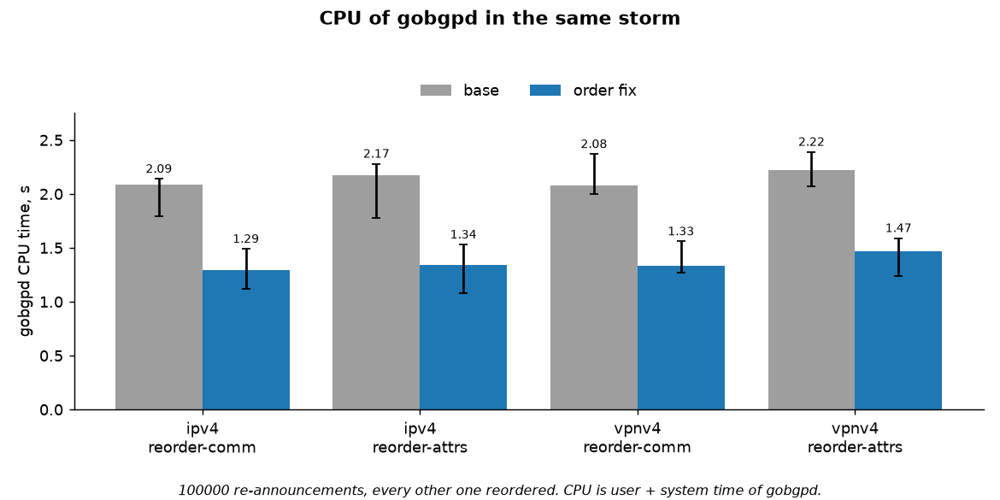
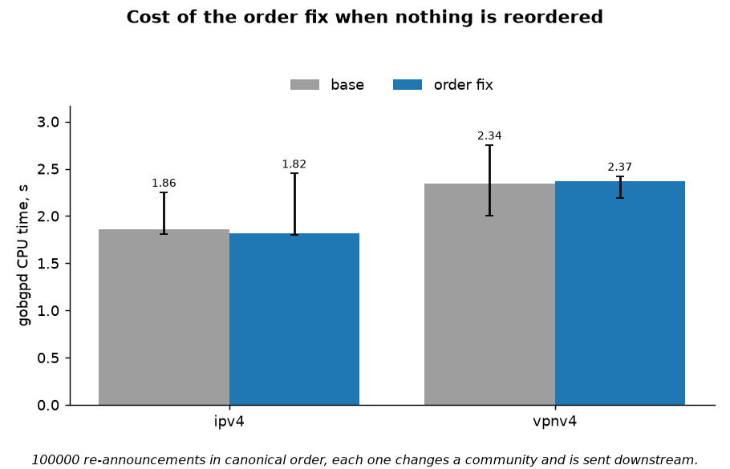
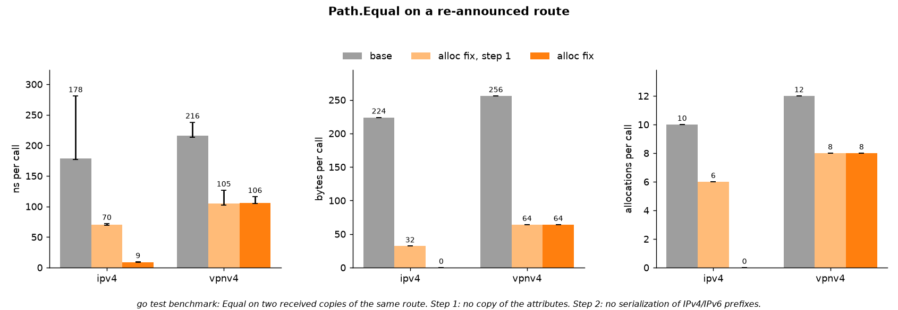
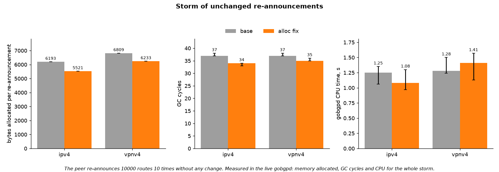
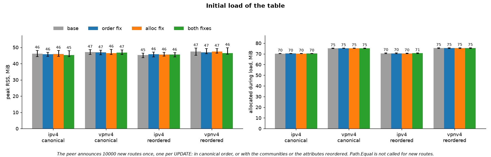

# gobgp Path.Equal bench

A reproducible bench for two independent changes to [GoBGP](https://github.com/osrg/gobgp)
that affect how a re-announced route is compared with the one already in the table.

| Fix | Commits | What it does |
|---|---|---|
| **order** | [`6f6cc2a7`](https://github.com/homka122/gobgp/commit/6f6cc2a78b94ee8092411baca0fa6df48b3c53ce) | Sorts the path attributes by type code and the COMMUNITIES values when an UPDATE is received. Before, the same route with its attributes or communities in another order counted as a new route: it got a new age and was sent again to all peers. |
| **alloc** | [`127d1ef8`](https://github.com/homka122/gobgp/commit/127d1ef857eebd310285c08b0d7072da20e75079), [`35f6e060`](https://github.com/homka122/gobgp/commit/35f6e0602066ff0a71d7ec956b19157353998a82) | `Path.Equal` without allocations: it reads the attributes without copying them (step 1) and compares IPv4/IPv6 prefixes without serializing them (step 2). |

Both are on the [`path-equal`](https://github.com/homka122/gobgp/tree/path-equal) branch, on top of
osrg/gobgp master `e9ac84bf`. The head of the branch, `65721d4e`, differs from the measured `35f6e060`
only by a removed code comment. The fixes touch different files, so the bench builds each one on its own:

| Variant | Code |
|---|---|
| `base` | `e9ac84bf`, upstream master |
| `order` | base + order fix |
| `alloc1` | base + alloc fix step 1 (micro benchmarks only) |
| `alloc` | base + alloc fix |
| `both` | base + both fixes |

## Results

Full run in the Docker container: Linux arm64 VM with 4 CPUs on an Apple M2, Go 1.27.2.
10 000 prefixes re-announced 10 times (100 000 re-announcements), 5 repetitions per cell.
Raw data, environment and all numbers: [results/full](results/full)
([summary.md](results/full/summary.md), [env.json](results/full/env.json), [raw/](results/full/raw)).

### Order fix

**When a peer changes the order, base sends every route again; with the fix nothing goes out.**
This holds for both IPv4 and VPNv4, and whether the communities or the attributes are reordered.


**gobgpd spends 34–38% less CPU on such a storm.** The route is not re-advertised, so there is
nothing to build and send downstream.



**When the order is stable, the fix costs nothing measurable: 1.86 → 1.82 s on IPv4, 2.34 → 2.37 s on VPNv4.**
Each route in this storm really changes and is sent downstream.



### Alloc fix

**`Path.Equal` no longer allocates for IPv4/IPv6 routes: 10 → 0 allocations, 178 → 9 ns.**
VPNv4 gets step 1 only, 12 → 8 allocations and 216 → 106 ns: its NLRI still goes through
`Serialize`, on purpose, because it carries the label outside the route key.



**In a live storm of unchanged routes gobgpd allocates 11% less per route on IPv4 and 8.5% less
on VPNv4, with a few GC cycles fewer.** The allocation drop is the same in every run. The CPU
effect is smaller than the run-to-run noise of a live process: the medians move both ways
(unchanged routes: IPv4 −14%, VPNv4 +10%), and the min–max ranges of base and alloc overlap.

The share is modest because `Equal` is one step of many per UPDATE: the rest is reading and
parsing the message, the FSM and the tables. The `go test` benchmark of the table chain alone
(`ProcessMessage → AdjRib → TableManager`) shows the same direction:

| IPv4 | base | alloc | |
|---|---|---|---|
| ns/op | 1653 | 1138 | −31% |
| B/op | 1439 | 976 | −32% |
| allocs/op | 58 | 38 | −34% |



### Together

**The fixes add up.** For reordered routes the order fix removes most of the work, and the alloc
fix makes the comparison that is left cheaper: 2.09 → 1.17 s CPU on the IPv4 `reorder-comm` storm,
2.17 → 1.07 s on `reorder-attrs`.


### What the fixes do not change

**The memory of the initial load is the same in all variants, within 0.3%, both when the table
comes in canonical order and when it comes reordered.** `Path.Equal` is only called when a route
already exists, so the alloc fix does not touch the load.

The order fix does cost something on a reordered load: it copies a COMMUNITIES attribute that is
out of order, once per UPDATE. The `go test` benchmark of `ProcessMessage` on an UPDATE with one
prefix:

| IPv4, one prefix per UPDATE | base | order fix |
|---|---|---|
| canonical order | 375 ns, 480 B, 19 allocs | 398 ns, 480 B, 19 allocs |
| communities out of order | 374 ns, 480 B, 19 allocs | 429 ns, 528 B, 21 allocs |

That is 48 B per UPDATE, ~0.5 MiB for the 10 000 UPDATEs of this load, which is within the
run-to-run spread of the live numbers. With more prefixes per UPDATE the cost is shared by all
of them.



### Earlier runs

[results/e2cd8b1f](results/e2cd8b1f) is the same harness on upstream master `e2cd8b1f`, with an
earlier version of step 2 that built the serialized bytes of a prefix in an array instead of
comparing `netip.Prefix` values (tag
[`bench-base-e2cd8b1f`](https://github.com/homka122/gobgp/tree/bench-base-e2cd8b1f)).

[results/2966efd1](results/2966efd1) is the same full run on the previous upstream master
`2966efd1`, before upstream moved the next hop out of the path attributes. The commits it used are
kept under the tag [`bench-base-2966efd1`](https://github.com/homka122/gobgp/tree/bench-base-2966efd1).
It was measured with an earlier harness that ended a phase on a quiet period instead of the
marker route and checked less of the traffic. The picture is the same.

## How it works

```
blaster ──BGP──▶ gobgpd <variant> ──BGP──▶ sink
AS 100            AS 200                  AS 300
```

- **blaster** is a minimal BGP speaker that builds every UPDATE itself, so it controls the order
  of the attributes and of the communities on the wire. It announces N prefixes (one per UPDATE),
  then re-announces all of them R times in one of four modes:
  - `same`: byte-for-byte the same UPDATEs;
  - `change`: one community value changes every round, so every route really changes;
  - `reorder-comm`: every other round the communities come in reverse order;
  - `reorder-attrs`: every other round COMMUNITIES comes before the other attributes.

  In the two reorder modes the initial load already uses the reordered form.
- **sink** is the downstream peer: it counts the routes gobgpd sends it.
- **gobgpd** is the variant under test. In the container it is pinned to CPUs 0–1 with
  `GOMAXPROCS=2`; blaster and sink run on CPUs 2–3.
- **harness/run.py** runs one variant per run: start, load the table, run the storm. A phase ends
  when a marker route that blaster sends right after it reaches the sink. gobgpd handles the
  UPDATEs of a peer one by one in the receive loop and sends to a peer through a FIFO queue, so
  the marker arrives only after gobgpd has handled the whole phase and sent everything it caused.
  It reads:
  - CPU (user + system) and RSS of gobgpd from outside with psutil;
  - `runtime.MemStats` from the pprof page of gobgpd, once before and once after each phase;
  - every GC cycle from `GODEBUG=gctrace=1`.

  Nothing polls gobgpd while it works: one `/metrics` scrape allocates ~160 KiB inside gobgpd and
  would be counted as its garbage. The pprof page read before a phase also allocates in gobgpd
  when it builds the heap profile; every run measures this as `probe_alloc` (median 36 KiB, at most 70 KiB per phase), which is
  counted in the phase and is far below the differences shown.

  The run fails unless blaster sent exactly what the mode says, the sink got all N routes on
  load, no withdrawals at all, and exactly the expected routes in the storm: N×R in `change`,
  0 in `same`, and in the reorder modes N×R without the order fix and 0 with it.
- Variants are interleaved in a shuffled order within every repetition, so drift of the machine
  is not mistaken for a difference between variants. Each chart shows the median over the
  repetitions, with min–max whiskers.
- **harness/micro.py** runs `go test` benchmarks from [micro/bench_test.go](micro/bench_test.go)
  on every variant: `Path.Equal` on two received copies of a route, and the
  `ProcessMessage → AdjRib → TableManager` chain on a storm of re-announcements.

## Run it

Needs Docker. Everything, including the clone and the build of gobgp, happens in the container.

```bash
make docker-quick   # ~5 min: 2k prefixes x 4 rounds, 2 repetitions -> results/quick
make docker-all     # ~40 min: 10k prefixes x 10 rounds, 5 repetitions -> results/full
```

On macOS, keep the machine awake (`caffeinate -i make docker-all`): a sleeping VM stalls a run.

Without Docker (Linux or macOS, needs Go and [uv](https://docs.astral.sh/uv/)):

```bash
scripts/build.sh    # clones gobgp into work/, builds all variants, blaster and sink
make quick          # on macOS only 127.0.0.1 and ::1 work, which are the defaults
```

The commits under test are pinned in [versions.env](versions.env).

## Limitations

- One peer, 10 000 prefixes, one prefix per UPDATE, all on loopback. The numbers show the
  direction and the size of the effect, not the throughput of a production router.
- The routes go into the global table with no policies. A route changed by an import policy
  still takes the old, copying path in `Path.Equal`.
- The order fix only covers routes received over BGP, not routes added through the gRPC API.
