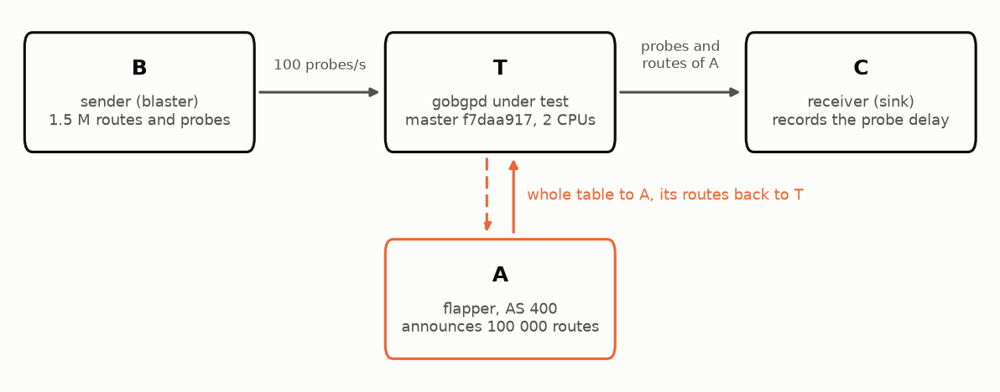
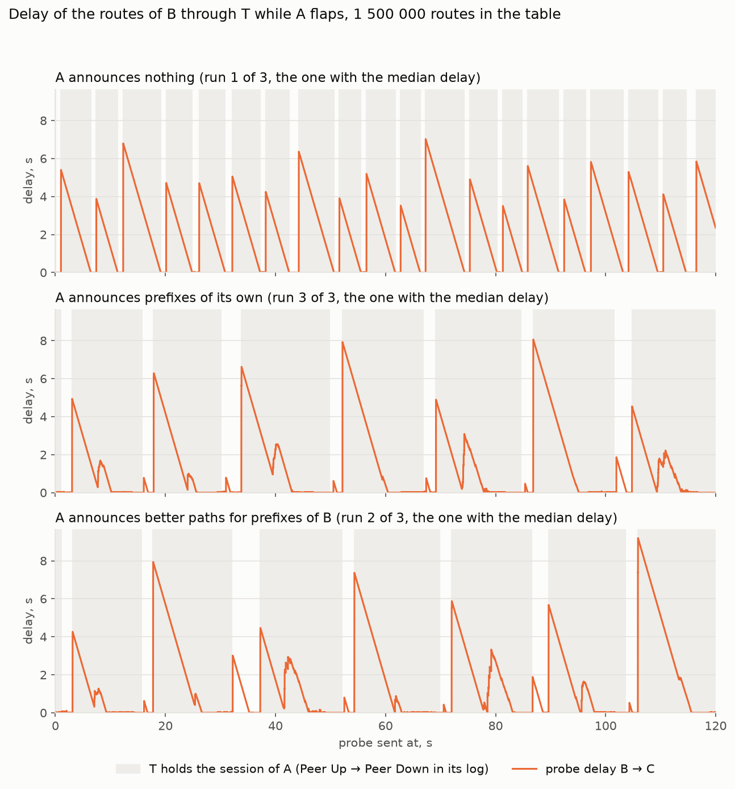

# A flapping peer that announces routes (November 2026)

A follow-up to [2026-11-peer-flap](../2026-11-peer-flap), where the flapping peer A only received. Here A also announces 100 000 routes every time it comes up. Does that make the flap worse for the other peers?



## Scenario

T is the gobgpd under test. B sends it routes, C receives them, A both receives and announces.

- B loads 1 500 000 routes into T, each with a community of its own. Then for 120 s B sends 100 probes a second; C records how long each took through T.
- A drops TCP without a NOTIFICATION and connects again every 1 s. It drops each session before T has sent it any of the table. Three variants:
  - **announces nothing**: the control, A only flaps, as in the first study, and drops 1 s after the session came up;
  - **own prefixes**: A announces 100 000 routes, 100.0.0.0/24 on, which nobody else has; T adds them and withdraws them on every flap;
  - **better paths**: A announces the first 100 000 prefixes of B with a shorter AS_PATH (`400` against `100 64512`); the best path of T moves to A and back on every flap.
- With routes, A sends them 500 to an UPDATE, all with the same attributes, and drops 1 s after they went out. They fit in the socket buffers, so they go out 0.01–0.04 s after the session comes up, and T reads them only after it has prepared the whole table for A.
- B and C offer a Hold Time of 3 s and end the session after 3 s of silence from T, as T does after 3 s of silence from them.
- gobgpd is master [`f7daa917`](https://github.com/osrg/gobgp/commit/f7daa917) on 2 CPUs with `GOMEMLIMIT=6GiB`, 75% of the 8 GiB of the Docker VM; production sets one too. Each variant ran 3 times. The control ran a day later on a binary rebuilt from the same revision.

## Result

| | A stays up, own prefixes | A flaps, announces nothing | A flaps, own prefixes | A flaps, better paths |
|---|---|---|---|---|
| probe delay, median | 1 ms (0–1 ms) | 2.0 s (1.6–2.5 s) | 249 ms (212–430 ms) | 473 ms (372–479 ms) |
| probe delay, 99th percentile | 2 ms (1–13 ms) | 6.3 s (5.7–14.3 s) | 7.4 s (7.2–7.5 s) | 7.5 s (6.8–8.0 s) |
| probe delay, max | 58 ms (20–160 ms) | 7.0 s (6.3–15.4 s) | 8.1 s (7.9–8.3 s) | 8.3 s (7.3–9.2 s) |
| probes held up over 100 ms, per time A came up | — | 479 (467–815) | 898 (896–940) | 956 (946–964) |
| probes that reached C | 100% | 100% | 100% | 100% |
| sessions of B and C that ended | 0 | 0 | 0 | 0 |
| times A came up in 120 s | 0 | 19 (10–20) | 7 | 7 |
| time T held a session of A, median of those that ended | — | 5.0 s (4.4–7.9 s) | 14.7 s (14.3–14.7 s) | 14.4 s (14.0–14.8 s) |
| routes announced to C in the phase | 100 000 | 0 | 772 500 (738 000–782 500) | 1 378 000 (1 376 000–1 431 000) |
| routes withdrawn from C in the phase | 0 | 0 | 672 500 (638 000–782 500) | 0 |
| peak RSS of gobgpd | 4.5 GiB (4.5–4.7 GiB) | 5.5 GiB (5.3–5.7 GiB) | 5.7 GiB | 5.7 GiB |
| CPU of gobgpd in the phase | 9 s (9–15 s) | 159 s (154–188 s) | 190 s (182–192 s) | 191 s (191–194 s) |

Median of the 3 runs, min–max in brackets; 12 000 probes in every run. All numbers: [summary.md](results/summary.md).



Nothing breaks and everything arrives. A single flap costs more when A announces, but A flaps less often, so over the phase the routes of B are held up less:

- **One flap.** T holds the session of A 14–15 s instead of 5 s, and twice as many probes are held up over 100 ms per flap: about 900–960 instead of 480. By the code T ends the session only after it has read the routes of A that wait in the socket; we did not time that. The large saw of the table for A is the same 4–8 s. After it the chart shows a second hump of up to 3–4 s, sometimes merged with the saw, then no delay at all while T still holds the session, and a spike of 0.5–1 s, at times up to 3 s, around its end.
- **The phase.** A comes back only after T has ended its last session, so it comes up 7 times in 120 s instead of 19. The median delay falls from 2.0 s to 0.25–0.47 s. At the median of the 3 runs the worst delay of a run is 8.1–8.3 s against 7.0 s, but the worst single probe, 15.4 s, came in a control run.
- **The receiver.** Over the phase C gets about 100 000 announcements and 100 000 withdrawals per session of A with own prefixes. With better paths it gets about 180 000 announcements per session: the moves to A and back to B. The two variants cost T the same CPU and memory; the better paths hold up B a little longer.

One control run differs: T held one session of A for 33 s, from about 50 s to 83 s of the phase, and later, at 100 s, a probe waited 15.4 s. We did not find why.

The first study ran 60 s without `GOMEMLIMIT` and is not comparable: there A came up 7 times in 60 s and the delay was 3.6 s at the median and 12 s at worst. Here without `GOMEMLIMIT`, with own prefixes, the first flapping run peaked at 7.0 GiB of RSS. In the second gobgpd reached 7.2 GiB after 41 s of flapping and then stopped answering, likely out of the memory of the VM: every table built for A becomes garbage when its session ends, and without a limit Go collects only when the heap doubles.

A sends identical attributes from a peer that is already gone when T reads them; a peer with a full table of varied routes would cost T more.

## Run it

From the root of this repository, with gobgpd built from [`f7daa917`](https://github.com/osrg/gobgp/commit/f7daa917) for linux/arm64 (see [2026-11-peer-flap](../2026-11-peer-flap)):

```bash
S=studies/2026-11-peer-flap-announce
./bench run ../gobgpd-f7daa917 $S/control.toml $S/own.toml $S/overlap.toml --name announce
uv run $S/plots.py --results results/announce
```

About 75 minutes. Docker with 4 CPUs and 8 GiB on an Apple M2. Loopback, eBGP, no policies: the absolute numbers on a production server will differ.
