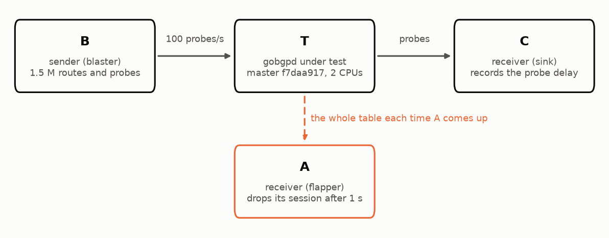

# A flapping peer next to a large table (November 2026)

The question: what happens to the other peers of gobgpd when one peer keeps reconnecting. Do their sessions end, are routes lost, how long are routes held up.



## Scenario

T is the gobgpd under test. B sends it routes, C and A receive them.

- B loads 1 500 000 routes into T. Every route carries a community of its own, so T cannot pack several of them into one UPDATE: the worst case for T.
- Then for 60 s B sends 100 probes a second. A probe is a /32 route of its own with the time it was sent in a large community. C records when each probe came.
- Two variants:
  - **A stays up**: its session holds the whole time;
  - **A flaps**: it drops TCP without a NOTIFICATION 1 s after its session came up and tries to connect again every 1 s.
- B and C offer a Hold Time of 3 s, the least RFC 4271 allows. Like a real router, B and C end the session when T is silent for 3 s, and T ends it when they are.
- gobgpd is master [`f7daa917`](https://github.com/osrg/gobgp/commit/f7daa917) on 2 CPUs. Each variant ran 3 times.

## Result

| | A stays up | A flaps |
|---|---|---|
| probes that reached C | 100% | 100% |
| sessions of B and C that ended | 0 | 0 |
| probe delay, median | 1 ms | 3.6 s (3.2–3.8) |
| probe delay, 99th percentile | 2 ms | 11.3 s (9.0–12.4) |
| probe delay, max | 12 ms (8–16) | 11.9 s (9.4–13.0) |
| times A came up in 60 s | 0 | 7 |
| peak RSS of gobgpd | 4.4 GiB (4.3–4.6) | 5.2 GiB (4.9–5.2) |

Median of the 3 runs, min–max in brackets; 6000 probes in every run. The same table is in [summary.md](results/summary.md).


Nothing breaks and everything arrives. But each time A comes up, the routes of B stop for 5.3–13 s. The grey bands are the time T held the session of A, from its log. The largest delay in each band equals its length; the other probes wait for what is left of it. Outside the bands no probe waits more than 0.1 s. A itself gets no route in its 1 s, and T sees its session end only at the end of the band, so A comes up every 6–14 s rather than every 2 s.

Why, from the gobgpd code (the bench does not measure this): when A comes up, T builds the whole table of 1.5 M routes for it. T handles the routes of B one by one and hands each to the peers in turn. While the table for A is built, the hand-out stops at A, and the next routes of B wait behind it. This is the `routeRefreshInProgress` lock of [osrg/gobgp#3349](https://github.com/osrg/gobgp/pull/3349).

The sessions of B and C stay up on both sides: B and C do not end them, so T kept sending KEEPALIVEs during the stalls, and the log of T has no Peer Down for B or C. Why T does not end the session of B, though it reads nothing from it for up to 13 s in the worst run, is again from the code: while a message waits to be handled, T restarts the hold timer ([`bdfa79f7`](https://github.com/osrg/gobgp/commit/bdfa79f7)).

## Run it

From the root of this repository, with gobgpd built from [`f7daa917`](https://github.com/osrg/gobgp/commit/f7daa917) for linux/arm64 (`GOOS=linux GOARCH=arm64 CGO_ENABLED=0 go build -o ../gobgpd-f7daa917 ./cmd/gobgpd` in a clone of osrg/gobgp):

```bash
S=studies/2026-11-peer-flap
./bench run ../gobgpd-f7daa917 $S/flap.toml --name 1500k
uv run $S/plots.py --results results
```

About 25 minutes. Docker with 4 CPUs and 8 GiB on an Apple M2: gobgpd on CPUs 0–1, the other peers on CPUs 2–3. Loopback, eBGP, no policies: the absolute numbers on a production server will differ.
