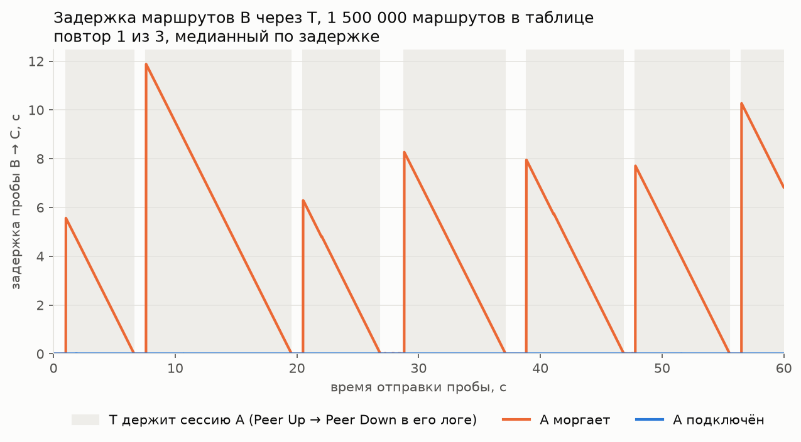

# Моргающий сосед рядом с большой таблицей (ноябрь 2026)

Вопрос: что будет с остальными соседями gobgpd, если один сосед бесконечно переподключается. Рвутся ли их сессии, теряются ли маршруты, насколько маршруты задерживаются.


## Сценарий

T — gobgpd под тестом. B шлёт ему маршруты, C и A их получают.

- B загружает в T 1 500 000 маршрутов. У каждого маршрута свой community, поэтому T не может упаковать их по несколько в один UPDATE. Для T это худший случай.
- Затем 60 с B шлёт 100 проб в секунду. Проба — отдельный маршрут /32, время отправки записано в его large community. C записывает, когда каждая проба пришла.
- Два варианта:
  - **A подключён** — сессия держится всё время;
  - **A моргает** — рвёт TCP без NOTIFICATION через 1 с после подъёма и переподключается раз в 1 с.
- Hold time у B и C 3 с, это минимум по RFC 4271. Как настоящий роутер, B и C рвут сессию, если T молчит 3 с, и T рвёт её, если 3 с молчат они.
- gobgpd — master [`f7daa917`](https://github.com/osrg/gobgp/commit/f7daa917), 2 ядра. Каждый вариант прогнан 3 раза.

## Результат

| | A подключён | A моргает |
|---|---|---|
| пробы дошли до C | 100% | 100% |
| сессий B и C оборвалось | 0 | 0 |
| задержка проб, медиана | 1 мс | 3,6 с (3,2–3,8) |
| задержка проб, 99-й перцентиль | 2 мс | 11,3 с (9,0–12,4) |
| задержка проб, максимум | 12 мс (8–16) | 11,9 с (9,4–13,0) |
| подъёмов A за 60 с | 0 | 7 |
| пиковый RSS gobgpd | 4,4 ГиБ (4,3–4,6) | 5,2 ГиБ (4,9–5,2) |

Медиана трёх прогонов, в скобках минимум и максимум; в каждом прогоне 6000 проб. Та же таблица — в [summary.md](results/summary.md).



Ничего не падает, и всё доходит. Но каждый подъём A останавливает маршруты от B на 5,3–13 с. Серые полосы на графике — время, пока T держал сессию A, по его логу. Наибольшая задержка в каждой полосе равна её длине, остальные пробы ждут остаток. Вне полос задержка не больше 0,1 с. Сам A получает за свою секунду 0 маршрутов, и T замечает его обрыв только в конце полосы. Поэтому A поднимается раз в 6–14 с, а не раз в 2 с.

Почему так, по коду gobgpd (стенд это не измеряет): когда A поднимается, T собирает для него всю таблицу в 1,5 млн маршрутов. Маршруты B T обрабатывает по одному и раздаёт каждый соседям по очереди. Пока таблица для A собирается, раздача встаёт на A, и следующие маршруты B ждут за ней. Это замок `routeRefreshInProgress` из [osrg/gobgp#3349](https://github.com/osrg/gobgp/pull/3349).

Сессии B и C при этом живы с обеих сторон: B и C не рвут их, значит KEEPALIVE от T шли и во время остановки, и в логе T нет Peer Down для B и C. Почему T не рвёт сессию B, хотя до 13 с (в худшем прогоне) не читает от неё сообщения, — тоже по коду: пока маршрут ждёт обработки, T перезапускает hold timer ([`bdfa79f7`](https://github.com/osrg/gobgp/commit/bdfa79f7)).

## Как повторить

Из корня этого репозитория, gobgpd собран из [`f7daa917`](https://github.com/osrg/gobgp/commit/f7daa917) под linux/arm64 (`GOOS=linux GOARCH=arm64 CGO_ENABLED=0 go build -o ../gobgpd-f7daa917 ./cmd/gobgpd` в клоне osrg/gobgp):

```bash
S=studies/2026-11-peer-flap
./bench run ../gobgpd-f7daa917 $S/flap.toml --name 1500k
uv run $S/plots.py --results results
```

Около 25 минут. Docker с 4 CPU и 8 ГиБ на Apple M2: gobgpd на CPU 0–1, остальные участники на CPU 2–3. Loopback, eBGP, без политик: абсолютные цифры на боевом сервере будут другими.
