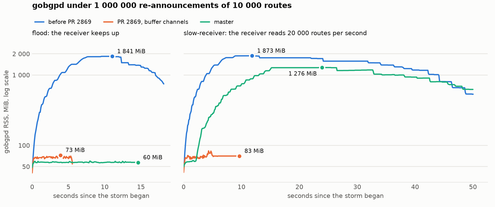

# Update queues under a storm (November 2026)

Up to v3, gobgpd kept two unbounded queues per peer: one for UPDATEs it had read but not yet
processed, one for routes it had not yet sent. [PR 2869](https://github.com/osrg/gobgp/pull/2869)
showed such a queue growing to 4 GB under a storm of re-announcements and proposed *buffer
channels*: queues that keep only the latest version of each route. Instead of merging it, v4.0.0
[removed the incoming queue](https://github.com/osrg/gobgp/pull/2993), and the PR was closed with
a note that the outgoing queue, still unbounded, may have the same problem.

Two questions about master:

1. Without the incoming queue, does memory stay flat under a storm? Yes, at 60 MiB; the code
   before the PR reaches 1841 MiB.
2. Does the outgoing queue grow when a peer reads slowly? Yes, to 1276 MiB when the receiver
   reads 20 000 routes per second. With the PR's buffer channels gobgpd stays at 83 MiB.

## Scenario and result

A sender announces 10 000 routes to gobgpd, which advertises them to one receiver. Then the
sender announces the same routes 100 more times, each time with a different community value:
1 000 000 re-announcements, as fast as gobgpd reads them. In [flood](flood.toml) the receiver
reads as fast as it can, in [slow-receiver](slow-receiver.toml) 20 000 routes per second. Every
route also carries a community of its own, so that gobgpd cannot pack many routes into one UPDATE.

Peak RSS of gobgpd during the storm, MiB, median of 3 runs. Before the storm it is 40–50 MiB.

| gobgpd | flood | slow-receiver |
|---|---|---|
| before PR 2869 | 1841 | 1873 |
| PR 2869, buffer channels | 73 | 83 |
| master | 60 | **1276** |



Each line is the run with the median peak; the number next to it is that peak. A line ends when
the receiver gets the last route.

In `flood` the code before the PR reads the whole storm in 5.5 s and finishes processing it at
18 s; the backlog sits in memory. master processes each UPDATE before it reads the next one, so
the sender takes 15 s and memory stays flat.

In `slow-receiver` master's memory grows until the sender is done, after 13–15 s. By then the
receiver has read less than a third of the re-announcements, and the rest waits in gobgpd's
queue for that peer.

The PR's buffer channels, on both the incoming and the outgoing side, stay flat because a newer
version of a route replaces the one still in the queue. So the receiver gets fewer
re-announcements: about a quarter of them in `flood`, a fifth in `slow-receiver`. The bench
counts them; it does not check that the last version of each route is among them. master also
keeps only the last version of a route, but only within one batch of at most 2048 queued
messages ([e0d6b99f](https://github.com/osrg/gobgp/commit/e0d6b99f)). Here two versions of a
route are 10 000 messages apart, so a batch never holds both.

`flood` also runs a second storm, of byte-identical re-announcements, which gobgpd does not
forward. It is not in the table or the chart above.

Ranges, times and delivered counts of both storms: [summary.md](results/summary.md). Raw data:
[results](results).

## Code under test

Three commits of [osrg/gobgp](https://github.com/osrg/gobgp), built with Go 1.27.1:

| gobgpd | commit | notes |
|---|---|---|
| before PR 2869 | `f677e0be` | master of 24 June 2025, the base commit of the PR |
| PR 2869, buffer channels | `41961d8b` | buffer channels in both directions for both peers; default channel size, no timeout |
| master | `f7daa917` | 10 November 2026, 25 commits after v4.11.0 |

## Run it

Build the three binaries in a clone of osrg/gobgp (`arm64` for a Mac with Apple silicon):

```bash
git fetch origin pull/2869/head
for c in f677e0be 41961d8b f7daa917; do
  git checkout -q $c && GOOS=linux GOARCH=arm64 CGO_ENABLED=0 go build -o ../gobgpd-$c ./cmd/gobgpd
done
```

Then, from the root of this repository:

```bash
S=studies/2026-11-update-queues
./bench run ../gobgpd-f677e0be $S/flood.toml $S/slow-receiver.toml --name base
./bench run ../gobgpd-41961d8b $S/flood.toml $S/slow-receiver.toml --name pr2869 \
  --neighbor-config 'incoming-channel = { channel-type = "buffer" }
outgoing-channel = { channel-type = "buffer" }'
./bench run ../gobgpd-f7daa917 $S/flood.toml $S/slow-receiver.toml --name master
uv run $S/plots.py --results results
```

About 12 minutes in all. The runs, the chart and the table are written to `results/` at the
repository root; `$S/results` holds the runs reported here. For the same bench code, check out
the commit that added this study.

## Environment and limitations

Docker VM with 4 CPUs on an Apple M2. gobgpd is pinned to CPUs 0–1 of the VM with
`GOMAXPROCS=2`, the sender and the receiver to CPUs 2–3. RSS of gobgpd is sampled from outside
the process every 0.1 s. The [main README](../../README.md) describes what a run does.

One sender and one receiver over loopback on a laptop, eBGP, no policies: absolute numbers will
differ on a production router. The receiver's rate in `slow-receiver` is arbitrary; which real
peers fall that far behind gobgpd was not measured.
